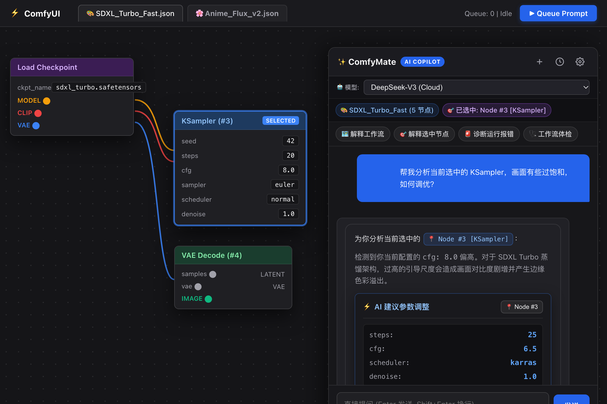
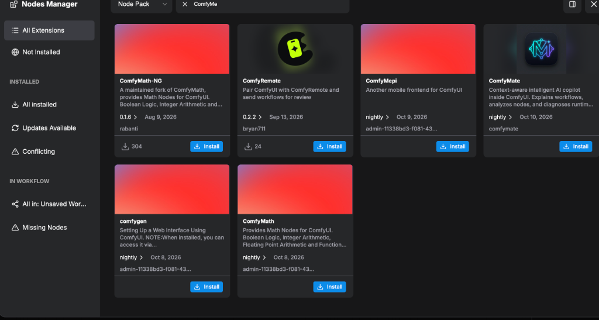
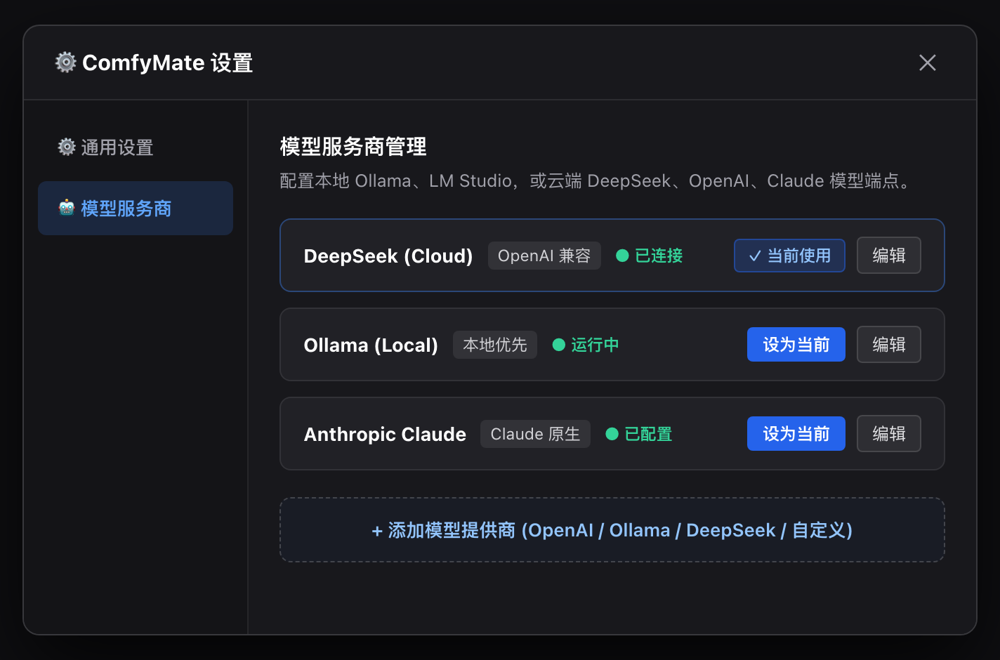
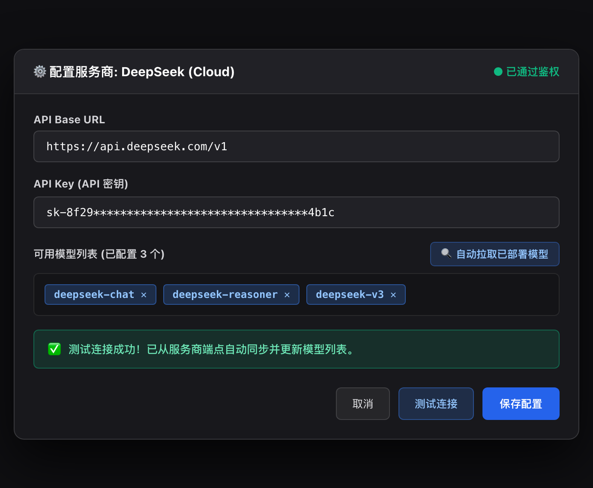
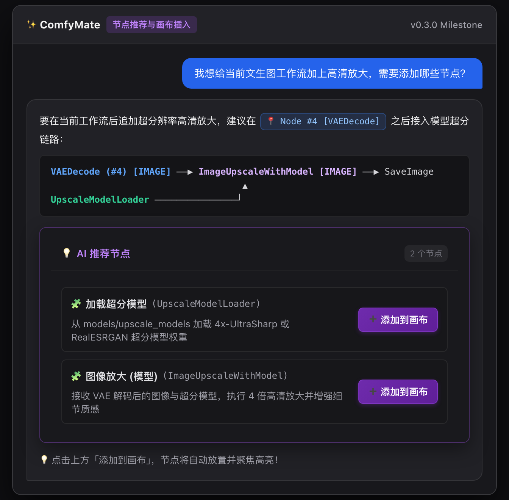

# ComfyMate 🤖

[ [English](README.md) | 简体中文 ]

<p align="center">
  
</p>

<p align="center">
  <b>深度嵌入 ComfyUI 画布的 AI 智能副驾驶 — 感知工作流拓扑、秒级排查报错、一键参数调优与节点推荐。</b>
</p>

<p align="center">
  
</p>

> **ComfyMate 是一个深度嵌入 ComfyUI 画布、真正懂工作流上下文的 AI 智能助手。**  
> 无需离开 ComfyUI 界面，即可实时感知画布拓扑、深度解析节点连接与参数含义、秒级一键排查运行时报错。

---

## 🌟 为什么选择 ComfyMate？

市面上的很多 AI 聊天插件只是一个独立的悬浮聊天窗，每次遇到问题都需要手动复制粘贴节点名称、参数、甚至冗长的终端报错日志。

**ComfyMate 完全不同。** 它作为 ComfyUI 原生扩展，与画布底层深度绑定：
- 🧠 **工作流拓扑自动感知**：自动将当前画布中复杂的节点网络、连线关系和参数配置提取为高密度 DSL，AI 真正看懂“数据从哪里来、流向哪里”。
- 🎯 **选中节点精准聚焦**：在画板中点击任意节点，ComfyMate 立即捕获该节点及其上下游所有输入输出，有针对性地回答细节。
- 🔍 **节点点击直达与脉冲高亮**：对话中提及的节点标签（如 `Node #3 [KSampler]`）均可交互点击。点击后画布镜头自动平移居中并附带 3 级高亮脉冲动画，在几百个节点的复杂画布中秒速定位。
- ⚡ **一键应用参数调优与撤销**：大模型给出的参数优化建议直接渲染为交互操作卡片，点击「⚡ 一键应用」即可将参数精准填入对应节点 Widget，并支持随时「↩️ 撤回」恢复先前数值。
- 💡 **动态节点知识库与一键上画布**：实时自省已安装节点定义与参数取值范围，大模型提供精准节点推荐卡片，一键「➕ 添加到画布」自动排布与脉冲聚焦。
- 🔗 **智能自动连线与链路对接 (Smart Auto-Connect)**：大模型推导上下游缺失连线并输出操作卡片，自动校验端口类型兼容性，点击「🔗 一键连线」直连画布端口，支持一键撤销断开。
- 📐 **一键工作流拓扑规整 (Auto Layout)**：基于 Sugiyama 分层拓扑框架与重心法交叉消除算法，一键梳理错综复杂的飞线与重叠节点，260ms 平滑动画排版与无损坐标撤回复原。
- 🚀 **闭环测试出图与多模态反思评价 (Closed-Loop Agent)**：一键向 ComfyUI 队列下发生图任务，实时监听进度，出图后自动捕获并直连视觉大模型（VLM）开展审美与质量质检，形成“调参 -> 出图 -> 反思质检 -> 循环优化”闭环。
- 🗂️ **多画布专属独立记忆与历史抽屉**：切换 ComfyUI 画布标签页时自动加载对应专属对话上下文，历史抽屉支持会话切换、重命名与持久化备份。
- 🩺 **工作流健康体检 (Workflow Doctor)**：一键对画布执行静态拓扑与连线质检，在排队出图前自动侦测核心连线缺失、空提示词、非标 Latent 尺寸及浮动孤立节点。
- 🖼️ **多模态视觉直连 (Vision)**：支持直接从剪贴板粘贴（`Cmd+V` / `Ctrl+V`）或拖拽图片到输入框，与 AI 探讨生图效果对比、节点配置截图或报错图像。
- 💾 **零丢失持久化存储 (Update-Safe)**：配置信息、对话历史与图片附件自动落盘至 ComfyUI 官方标准用户目录（`ComfyUI/user/default/comfymate/`），插件更新、重新拉取代码或 Registry 重装均 100% 保留配置与历史记录。
- 🚨 **报错一键自动诊断**：自动捕获 ComfyUI 执行异常与堆栈日志，逆向回溯推导模型缺失、尺寸不匹配、未连接或配置错误。
- 🏠 **本地模型优先 (Local-First)**：深度适配 **Ollama** 与 **LM Studio**，工作流结构与生图提示词 100% 留在本地，安全且零调用成本。
- ⚡ **主流云端大模型全兼容**：原生支持 **DeepSeek**、**OpenAI**、**Anthropic (Claude)**、**OpenRouter**、**SiliconFlow (硅基流动)** 等任意兼容 OpenAI 规范的 API。
- 🗜️ **超高压缩比拓扑算法**：过滤冗余的坐标、尺寸和样式数据，画布上下文压缩率超 80%+，大幅节省 Token 消耗并加速推理。

---

## 🚀 安装指南

### 方法 1：Git Clone 安装（推荐）

1. 打开终端，进入你的 ComfyUI 根目录下的 `custom_nodes` 文件夹：
   ```bash
   cd ComfyUI/custom_nodes/
   git clone https://github.com/jjeejj/ComfyMate.git
   ```
2. 重启 ComfyUI 即可。

*(依赖说明：ComfyMate 仅依赖 Python 标准库及 ComfyUI 原生自带的 `aiohttp`，无需额外安装繁琐依赖)。*

### 方法 2：Comfy Registry / Nodes Manager 安装（推荐）

ComfyMate 支持通过现代官方 [Comfy Registry](https://registry.comfy.org) 一键安装：
```bash
comfy node registry-install comfymate
```
在 ComfyUI 官方 Nodes Manager / ComfyUI-Manager 搜索框输入 `ComfyMate`，点击 **Install** 即可。  

<p align="center">
  
</p>

> 详细发布与维护指南请参阅 [发布文档 (Publishing Guide)](docs/PUBLISHING.md)。

---

## 📖 使用说明 (How to Use)

ComfyMate 设计追求极致的顺手与零心智负担。以下是完整的使用流程与核心功能说明：

### 1. 唤出/隐藏助手面板

你可以通过以下任意一种便捷方式随时打开 ComfyMate：

| 唤出方式 | 操作方法 |
| :--- | :--- |
| **右侧边吸附把手** | 点击屏幕右侧边居中的 **`✨ ComfyMate`** 垂直把手标签（不遮挡主画布，随时可点）。 |
| **全局快捷键** | 按 **`Alt + C`**（Windows / Linux）或 **`⌥ Option + C`**（macOS）。<br>*(同时也支持 `Cmd/Ctrl + J`、`Alt/Option + M`、`Cmd/Ctrl + Shift + M`，按 `Esc` 可快速收起)*。 |
| **节点右键菜单** | 右键点击画布中的任意节点 &rarr; 选择 **`✨ Explain this Node with ComfyMate`**（自动唤出并针对该节点提问）。 |
| **画布空白处右键** | 右键点击画布空白区域 &rarr; 选择 **`✨ Toggle ComfyMate Copilot`**。 |
| **顶部扩展菜单** | 点击顶部菜单栏的 `Extensions` &rarr; **`✨ ComfyMate AI Copilot`**。 |

> **提示：** 拖拽 ComfyMate 面板左边缘可自由调整窗口宽度，面板会自动记忆你的宽度偏好。

---

### 2. 快速上手：配置 LLM 模型

首次使用时，点击面板顶部的 **⚙️ 设置图标**（或欢迎气泡中的“前往配置”按钮）：

<p align="center">
  
</p>

点击对应服务商的 **编辑**（或下方 **+ 添加模型提供商**），输入 Base URL 与 API Key，并使用 **一键自动拉取已部署模型** 快速同步可用模型：

<p align="center">
  
</p>

#### 选项 A：本地模型 (Ollama / LM Studio) —— 推荐（私密、免费）
- **Ollama**：
  - **接口协议**：`OpenAI-Compatible`
  - **Base URL**：`http://localhost:11434/v1`
  - **API Key**：填写任意字符（如 `ollama`）
  - **模型名称**：填写本地已拉取的模型，如 `deepseek-r1:8b`、`llama3:8b`、`qwen2.5:7b` 等。
- **LM Studio**：
  - **Base URL**：`http://localhost:1234/v1`
  - **API Key**：`lm-studio`
  - **模型名称**：填写 LM Studio 中启动的模型标识。

#### 选项 B：云端模型 API
- **DeepSeek**：
  - **Base URL**：`https://api.deepseek.com`
  - **API Key**：填写你的 DeepSeek API Key（`sk-***`）
  - **模型名称**：`deepseek-chat` 或 `deepseek-reasoner`
- **OpenAI**：
  - 选择预设 **OpenAI**，填入 API Key，并选择 `gpt-4o`、`gpt-4o-mini` 或 `o3-mini`。
- **Anthropic (Claude)**：
  - 选择预设 **Anthropic**，填入 API Key，并选择 `claude-3-7-sonnet-20250219` 等模型。
- **OpenRouter / 硅基流动 / 其它中转**：
  - 填入对应服务商的 Base URL、API Key 与模型名称即可。

填写后点击 **测试连接**，验证无误后点击 **保存配置**。  
在聊天界面顶部，你可以通过 **模型切换下拉框** 随时无缝切换正在使用的模型。

---

### 3. 典型使用场景与交互指南

#### 场景 1：解读复杂/陌生工作流
当你从开源社区下载了一个复杂的节点流，不知道整体执行逻辑：
1. 在 ComfyUI 中载入该工作流。
2. 打开 ComfyMate，点击快捷操作胶囊 **`🗺️ 解释工作流`**（或直接在输入框发送：*“帮我梳理这个工作流的整体逻辑和生图链路”*）。
3. ComfyMate 会全盘分析节点拓扑（如 Checkpoint 加载 &rarr; CLIP 提示词编码 &rarr; KSampler 采样 &rarr; VAE 解码 &rarr; 图像后处理），输出清晰的模块化讲解。

#### 场景 2：探究具体节点的作用与参数
遇到不熟悉的节点（例如各种采样器、LoRA 堆叠器、ControlNet 预处理器）：
1. 在画布上**鼠标单选或框选**目标节点。
2. 观察面板顶部的上下文标签，会实时更新为 **`[已选节点: 1个]`**。
3. 点击 **`🎯 解释选中节点`**，或直接右键节点选择 **`✨ Explain this Node with ComfyMate`**。
4. 可以进一步追问深入问题：
   - *“这个 KSampler 中的 cfg 和 denoise 参数在这套工作流里具体起什么作用？”*
   - *“为什么这个节点的 latent 输入不是直接来自 Empty Latent？”*
   - *“这个 ControlNet 的 strength 推荐设置在什么范围？”*

#### 场景 3：运行报错一键排查定位
运行 ComfyUI 遇到红色节点报错时：
1. ComfyMate 会在后台自动拦截本次运行的异常堆栈与出错节点 ID。
2. 面板上下文状态栏亮起红色的 **`[🚨 检测到报错]`** 标签。
3. 点击 **`🚨 排查报错`** 胶囊按钮（或直接询问：*“刚才运行为什么报错了？”*）。
4. AI 会精确指出：
   - 报错节点名称与节点编号（如 `KSampler (#3)`）；
   - 导致错误的根本原因（例如：模型权重文件缺失、张量分辨率不兼容、VAE 格式不匹配、未连线的必要输入端口、显存超限等）；
   - 具体一步一步的修复步骤。

#### 场景 4：改造与扩展工作流建议与智能节点推荐 (v0.3.0)
想要给现有工作流添加新能力？例如：
- *“我想把这个文生图工作流改成图生图，需要替换或增加哪些节点？”*
- *“我想给这个生图工作流加上高清放大（Upscale / Hi-Res Fix），应该怎么连线？”*
- *“我想给人物生图加上 Face Detailer 面部重绘，应该怎么连线？”*

ComfyMate 会根据当前画布拓扑推导数据流向，给出精准节点推荐卡片，并支持 **一键「➕ 添加到画布」** 与自动居中高亮：

<p align="center">
  
</p>

#### 场景 5：剪贴板图片多模态直接对话
遇到生图瑕疵、复杂节点参数配置或界面错误：
1. 复制生图结果、局部截图或错误弹窗（支持微信/QQ/系统截图工具 `Cmd+Ctrl+Shift+4` 或 `Win+Shift+S`）。
2. 在 ComfyMate 输入框直接按 **`Cmd + V`**（或 **`Ctrl + V`**），或直接从桌面**拖拽图片**放入输入框。
3. 输入框上方将即时显示图片卡片缩略图（支持多图，最多 4 张）。
4. 向支持 Vision 的模型（如 `gpt-4o`、`claude-3-7-sonnet` 或本地视觉模型）提问：
    - *“这张生图的人物手指出现畸变，结合我当前工作流，推荐用哪个 Negative 提示词或 Inpaint 节点修复？”*
    - *“帮我看一下截图里的这个自定义节点参数设置是否合理？”*

#### 场景 6：出图前工作流体检 (Workflow Doctor)
在投入大量时间排队渲染前，预先筛查潜在隐患：
1. 点击输入框上方的 **`🩺 工作流体检`** 快捷胶囊（或发送：*“帮我检查一下这个工作流有没有遗漏或错误”*）。
2. ComfyMate 会对画布执行静态 AST 级深度体检。
3. 毫秒级精准诊断出常见配置疏漏：
   - KSampler 缺失关键输入（缺少 Model、Positive、Negative 或 Latent 连线）；
   - VAE 或 CLIP 悬空未连接；
   - 正向或反向提示词文本为空；
   - Latent 宽/高尺寸非标准数值（未按 8 或 64 整除，易导致模型报错或生图花屏）；
   - 画布上存在未连接任何端口的孤立冗余节点。
4. 输出条理清晰的体检报告，并提供针对性的修改建议。

#### 场景 7：画布双向交互：节点定位与一键参数应用
无需在庞大的工作流中眼花缭乱地手动寻找节点和逐个修改参数：
1. **点击定位节点**：当 ComfyMate 回复中出现节点徽标（如 `Node #3 [KSampler]`）时，点击该蓝色标签，画布镜头将平滑平移至该节点并居中，同时边框闪烁高亮脉冲，一目了然。
2. **一键应用参数**：当 AI 建议调节参数（例如优化 `steps: 25`、`cfg: 7.0`、`denoise: 0.65` 等）时，会自动生成交互卡片。点击 **`⚡ 一键应用`**，对应数值将直接写入画布中该节点的输入框。
3. **安全撤销回滚**：如果测试后希望还原原先设置，只需点击卡片上的 **`↩️ 撤回`**，参数立即无损恢复。

#### 场景 8：智能自动连线与链路对接 (Smart Auto-Connect)
新增节点或重构流程后无需手动在微小端口之间吃力拉线：
1. 询问 AI（如：*“我刚添加了 FaceDetailer，怎么和现有的 KSampler 和 VAE 连线？”* 或 *“帮我把 CheckpointLoaderSimple 的 MODEL 端口连到 KSampler”*）。
2. ComfyMate 会生成 **`🔗 AI 建议连线`** 交互卡片，清晰呈现源节点、输出端口、目标节点与输入端口。
3. 点击 **`🔗 一键连线`**，对应端口瞬间自动对接，画布平滑聚焦目标节点并闪烁脉冲。
4. 若连线不合心意，点击卡片上的 **`↩️ 撤回连线`** 即可瞬间断开并恢复先前状态。

#### 场景 9：一键工作流智能拓扑规整 (Auto Layout)
随着节点增多，画布往往杂乱无序、连线互相穿插遮挡：
1. 可通过三种方式触发规整：
   - 点击面板顶部的 **`📐` 整理排版按钮**；
   - 点击输入框上方的 **`📐 整理画布`** 快捷胶囊；
   - 让 AI 进行诊断后点击卡片中的 **`📐 一键整理排版`**。
2. 引擎采用经典 **Sugiyama 拓扑分层框架** 与 **重心法交叉最小化启发式算法**：
   - 自动确定流水线依赖深度（Loader &rarr; Encoder &rarr; Sampler &rarr; Decoder &rarr; SaveImage）；
   - 纵向根据上下游连线重心排列，并自动垂直居中，消除重叠与杂乱交错；
   - 附带 260ms 平滑过渡动画，体验丝滑流畅；
   - 卡片提供 **`↩️ 撤回排版`**，可 100% 还原排版前的位置坐标。

#### 场景 10：闭环测试出图与多模态反思评价 (Closed-Loop Test & Vision Eval)
调完参数或改完连线后，无需离开助手即可闭环检验出图质量：
1. 点击顶部 **`🚀` 按钮**、**`🚀 测试出图` 快捷胶囊**，或在 AI 给出调优建议后点击卡片中的 **`🚀 立即测试出图`**。
2. **实时状态追踪**：ComfyMate 深度接入 ComfyUI 执行事件流，卡片呈现动态呼吸光效与实时进度条（显示当前正在执行的节点名称与百分比）。
3. **成果自动捕获**：出图完成后，卡片内即时呈现**生成的图像缩略图**，点击可直接弹窗放大查看高清大图。
4. **多模态反思质检闭环**：点击卡片底部的 **`🔍 视觉多模态评估`**，系统自动将本次出图作为多模态图片输入提交给视觉大模型，由 AI 针对构图、细节、光影、肢体结构展开审美质检，并直接给出下一轮针对性的参数微调建议！
5. **报错一键求助**：若生成中断，卡片自动拦截报错并提供 **`🔧 诊断报错原因`** 按钮，一键让 AI 分析 Traceback 堆栈。

#### 场景 11：多画布专属独立记忆与会话历史抽屉 (Per-Workflow Chat & Sessions)
支持多项目并行与历史追溯：
1. **画布专属联动**：在 ComfyUI 顶部切换不同的工作流标签页时，ComfyMate 会自动无缝切换到该画布绑定的专属聊天上下文，互不串台、针对性极强。
2. **历史会话抽屉**：点击面板顶部的 **`🕒` 会话图标**，展开会话管理侧边抽屉，直观浏览过往对话列表，支持重命名和快速切换。

---

### 4. 通用设置与个性化调节

在 **⚙️ 设置 &rarr; 常规设置** 中，可进行个性化调整：
- **显示语言**：支持 **自动检测**（自动跟随 ComfyUI 语言设置或浏览器语言）、**简体中文** 与 **English**。
- **温度值 (Temperature)**：可拖动滑块从 0.0 至 1.5 自由调节，附带【严谨 0.2】、【平衡 0.7】、【发散 1.2】预设提示。
- **最大生成长度 (Max Output Tokens)**：支持 2048、4096（推荐）、8192 或 16384 Tokens。
- **清空历史 (🗑️)**：点击面板右上角垃圾桶图标，随时开启新一轮对话。
- **停止生成**：模型生成过程中，发送按钮会自动切换为“停止”，随时打断输出。

---

## ⚙️ 常见模型服务商配置对照表

| 服务商 | Base URL | 推荐模型示例 | 说明 |
| :--- | :--- | :--- | :--- |
| **Ollama** *(本地)* | `http://localhost:11434/v1` | `deepseek-r1:8b`, `qwen2.5:7b` | 免费、私密、纯离线、无需密钥 |
| **LM Studio** *(本地)* | `http://localhost:1234/v1` | 界面加载的模型名称 | 本地需开启 Local Server |
| **DeepSeek** | `https://api.deepseek.com` | `deepseek-chat`, `deepseek-reasoner` | 极高性价比与出色中文理解 |
| **OpenAI** | `https://api.openai.com/v1` | `gpt-4o`, `gpt-4o-mini`, `o3-mini` | 需要 OpenAI API 密钥 |
| **Anthropic** | `https://api.anthropic.com/v1` | `claude-3-7-sonnet-20250219` | 原生 Claude Messages 协议支持 |
| **OpenRouter** | `https://openrouter.ai/api/v1` | 任选支持模型 | 一个 Key 聚合全球数十种大模型 |


---

## 🛣️ 发展路线 (Roadmap)

- [x] **v0.1.0 (核心感知与多模态)**：
  - 画布拓扑轻量化提取与智能压缩
  - 选中节点上下文精准捕获与右键菜单直达
  - 执行异常与错误日志自动拦截排查
  - 多模型服务商支持 (Ollama, DeepSeek, OpenAI, Anthropic, OpenRouter 等)
  - 剪贴板图片多模态视觉对话 (Vision)
  - 顶栏快速模型切换器与全局快捷键体系
- [x] **v0.2.0 (画布交互闭环与工作流体检)**：
  - 🎯 节点点击直达居中与 3 级高亮脉冲动画
  - ⚡ AI 推荐参数一键写入与安全撤回回滚
  - 🩺 工作流体检 (Workflow Doctor)：执行前静态连线校验、尺寸检测与空提示词拦截
  - 💾 用户目录零丢失持久化存储 (`ComfyUI/user/default/comfymate/`)
  - 🧩 前端组件 HTML 模板化分离与动态 i18n 渲染引擎
- [x] **v0.3.0 (知识库与节点推荐上画布)**：
  - 📚 ComfyUI 运行时节点全量动态自省与离线兜底知识库
  - 🛡️ 官方输入输出与参数范围元数据注入，消除大模型幻觉
  - 💡 交互式节点推荐卡片与一键「➕ 添加到画布」
  - 🎯 智能自动排布（选区右侧或视口居中）与淡蓝发光聚焦脉冲
- [x] **v0.4.0 (自主工作流 Agent)**：
  - 🔗 智能自动连线与链路对接 (`connect_nodes` 交互卡片与一键撤销)
  - 📐 一键工作流智能拓扑规整 (`auto_layout` Sugiyama 分层算法引擎、平滑动画与撤销)
  - 🚀 闭环测试出图、实时进度监听与多模态反思质检 (`queue_prompt` 与 Vision 审美评价)
  - 🗂️ 多工作流标签页专属对话联动与会话抽屉管理 (Per-Workflow Session Sync)

---

## 📄 开源许可 (License)

本项目采用 [MIT 许可证](LICENSE)。
